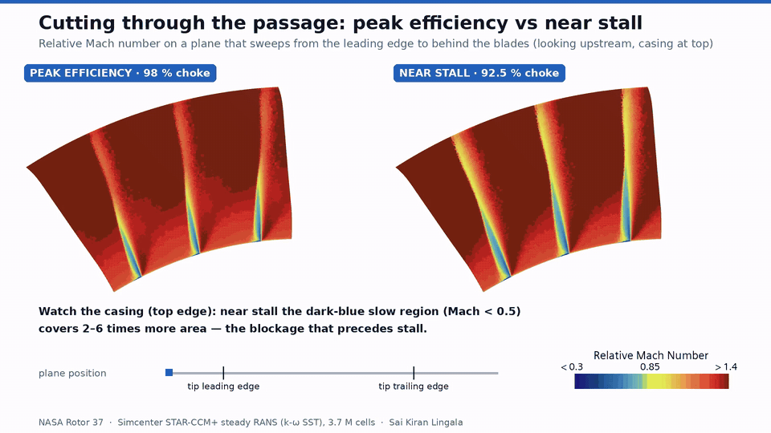
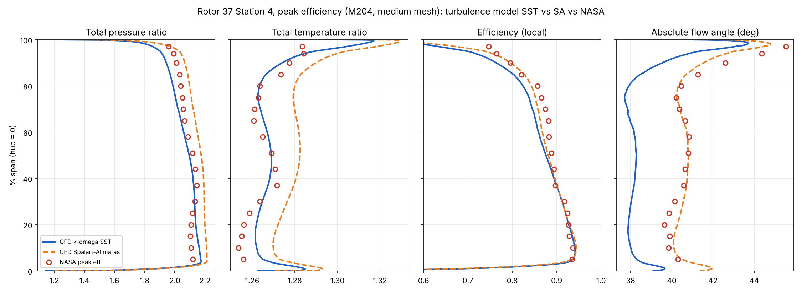
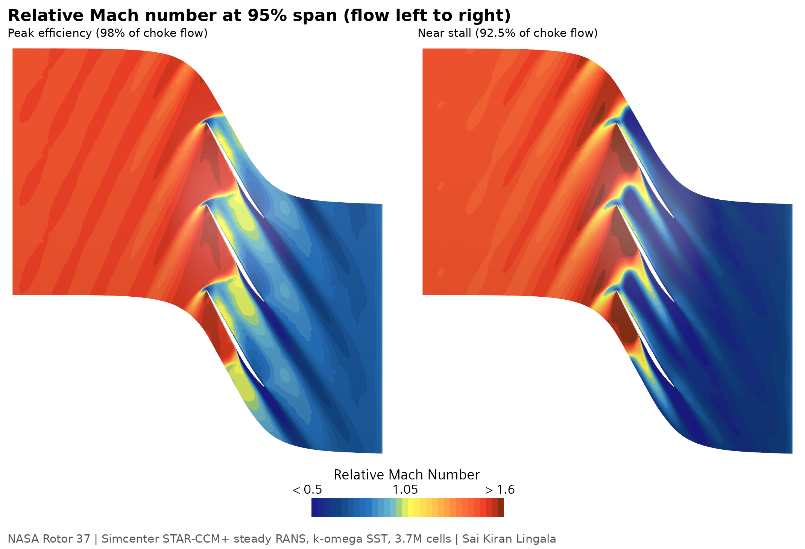
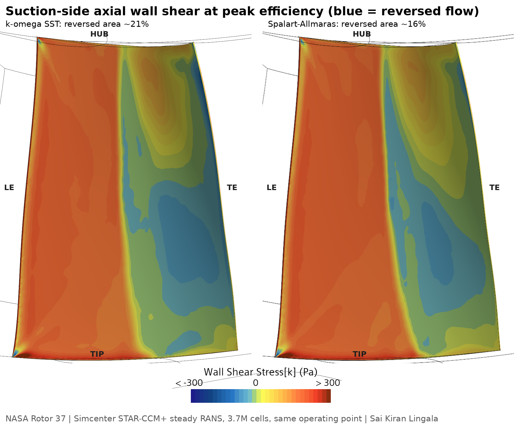

# NASA Rotor 37 — transonic compressor rotor CFD validation (Simcenter STAR-CCM+)

Steady RANS simulation of NASA Rotor 37, the isolated transonic axial compressor rotor used in the AGARD/ASME blind test, built from the published blade coordinates and validated against NASA measurements.



*Relative Mach number on a plane sweeping from the leading edge to behind the blades. Near stall, the slow region at the casing (dark blue, Mach < 0.5) covers 2–6 times more area. Full 51 s video with through-flow and tip-leakage streamlines: [videos/Rotor37_secondary_flows.mp4](videos/Rotor37_secondary_flows.mp4).*

## Key results

| | CFD (k-ω SST) | NASA | Difference |
|---|---|---|---|
| Total pressure ratio, peak efficiency | 2.0616 | 2.084 | −1.1 % |
| Adiabatic efficiency, peak efficiency | 0.857 | 0.879 | −2.2 pt |
| PR, 98 % → 93 % of choke | — | — | −0.8 to −1.3 % |

- **Mesh converged:** four meshes, 0.83 M → 5.97 M cells. Medium (3.71 M) → fine-lite changes PR by −0.12 % and efficiency by −0.03 pt. Conservative GCI: PR ±0.9 %, efficiency ±0.3 pt.
- **Turbulence model is the largest uncertainty:** Spalart-Allmaras vs SST on the same mesh changes PR by +3.9 % and efficiency by +0.83 pt — about four times the mesh uncertainty. The two models bracket NASA's PR.
- **Flow physics:** the passage shock from the leading edge separates the suction-side boundary layer (≈ 21 % of the surface reversed with SST, ≈ 16 % with SA); tip-leakage flow crosses each passage toward the next blade.
- **Toward stall** (98 % → 92.5 % of choke flow): the shock detaches and moves upstream; from mid-chord on, the outer 10 % of span is about 0.2 Mach slower and its area below Mach 0.5 is 2–6 times larger ([data](data/cfd/sweep_casing_band.csv), read from rendered frames).
- **Not captured with either model:** excess hub total pressure (no hub leakage path modelled) and a 7–11 pt efficiency deficit at 97 % span.







## Setup

| Item | Setting |
|---|---|
| Geometry | NASA "hot" (running) blade coordinates, built in Siemens NX; tip clearance 0.357 mm; no hub fillet |
| Domain | Single passage (1 of 36), rotational periodic; inlet z = −90 mm, outlet z = +180 mm |
| Mesh | Polyhedral + 30 prism layers, first cell ≈ 1 µm (y+ ≈ 1), ≈ 36 cells across the tip gap; 3.71 M cells |
| Physics | Steady, ideal gas, coupled flow + energy, k-ω SST (all-y+); Spalart-Allmaras for comparison |
| Frame | Moving reference frame, −1800 rad/s about +Z; casing and up/downstream hub stationary |
| Boundary conditions | Stagnation inlet 101 325 Pa / 288.15 K; radial-equilibrium outlet with target mass flow per point |
| Performance | Mass-averaged total pressure / temperature between NASA stations 1 (z = −41.9 mm) and 4 (z = 106.7 mm), lab frame |
| Solver | Simcenter STAR-CCM+ 2602, double precision, 7 cores |

Operating points are compared at the same fraction of each one's own choke flow (CFD 20.80 kg/s, NASA 20.88 kg/s).

## Repository contents

```
geometry/            r37_v2.stp / .x_t (fluid domain, named faces), r37_blade.stp
data/nasa/           NASA 100 % speed map and station 4 radial profiles
data/cfd/            speedline, grid study, turbulence-model and casing-band summary tables
data/cfd/station4_raw/  exported station 4 cell tables (lab-frame p0, T0, rho, velocity)
data/cfd/profiles/   circumferentially mass-averaged station 4 profiles
scripts/             post-processing (Python: numpy, scipy, matplotlib)
figures/             validation and flow-physics figures
videos/              flow animation
```

The STAR-CCM+ simulation files (≈ 1.6 GB each) are not included.

## Reproducing the profiles

```bash
pip install -r requirements.txt
# station-4 table -> radial profile:  csv  p01[Pa]  t01[K]  mdot_per_passage[kg/s]  out.csv
python scripts/st4_profile.py data/cfd/station4_raw/st4_M204.csv 101250 288.158 0.5667 cfd_M204_profile.csv
python scripts/compare.py data/cfd/profiles/cfd_M204_profile.csv peak_eff "M204" st4_M204_vs_NASA.png
python scripts/compare_models.py
python scripts/grid3.py
```

`st4_profile.py` replicates the passage periodically, interpolates onto a 600 × 600 r-θ grid, and mass-averages with ρ·Vz·r dr dθ weights; it reproduces STAR's integrated mass flow and performance to within 0.06 %.

## Limitations

Steady, single-passage RANS: cannot predict the stall event itself (the solution remains stable below NASA's stall flow). Separation extent depends on the turbulence model. Hub leakage and hub fillet are not modelled. Some post-processing values (Mach and wall-shear levels) were read from rendered images and are estimates.

## Next

- OpenFOAM comparison on the same mesh
- Hub leakage modelling to test the hub total-pressure excess

## References

- Reid, L. & Moore, R. D. (1978). *Design and overall performance of four highly loaded, high-speed inlet stages for an advanced high-pressure-ratio core compressor.* NASA TP-1337.
- Dunham, J. (ed.) (1998). *CFD validation for propulsion system components.* AGARD-AR-355.
- Chima, R. V. (2009). *SWIFT code assessment for two similar transonic compressors.* NASA TM-2009-215520.

## Author

Sai Kiran Lingala — [LinkedIn](https://www.linkedin.com/in/saikiranlingala27)
